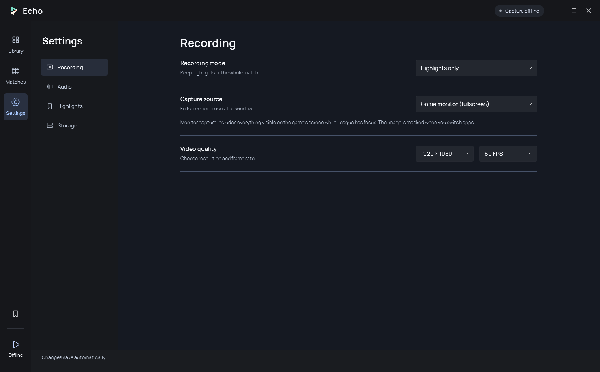

<p align="center"></p>

# Echo

**Keep the moment.** A local League of Legends recorder for Windows, built with C#, WPF and libobs.

Automatically preserve your kills, assists and deaths, or record a full match and return to its moments later. Game audio is on by default. Desktop audio and your microphone are optional.

> **Early development · v0.1.0-dev.** Native recording, replay saves, event fixtures and application-audio isolation have been exercised locally. A live practice session saved 15 clips from 28 kills and one death; live assists and longer stability remain open. Paired FPS measurements were cancelled in favor of normal-use feedback. There is no zero-FPS-impact claim and no public installer yet.

## What Echo does

- **Clips only:** one hardware encoder, a bounded encoded replay buffer, and event-driven saves with configurable lead-in and tail.
- **Full match:** record once, retain event ranges, and export only the moments you choose.
- **Your game's audio:** application audio by default; no automatic fallback to desktop sound. Enabling desktop sound captures the full mix without doubling the game source.
- **Local library:** English native WPF interface, a paged clip gallery, search/event filters, large player, fullscreen playback, volume/mute, optional trimming, safe deletion and MP4 export.
- **Manual moments:** configurable global shortcut, initially `Ctrl+Shift+F8`. Change or disable it in Highlights settings; conflicts are shown in the app.
- **Automatic settings:** selections save immediately; numeric edits save after a short typing pause. Recording-source changes apply to the next recording. Full matches appear in Matches while recording and become playable after preparation.
- **Cleaner highlights:** new recordings track intervals masked by the fullscreen focus guard. After gameplay, Echo can make highlight copies without those intervals, while preserving the full match and original media. Older recordings without this timing information are unchanged.
- **Independent recorder:** closing the library leaves recording running. A small supervisor keeps detection available; each native capture worker handles one recording lifecycle. Tray controls pause capture, resume it, save a manual moment or exit the recorder. After a native fault, capture pauses with an error rather than repeatedly restarting against the same game.
- **Hardware first:** NVENC, AMD AMF or Intel QSV H.264. Recording does not silently fall back to CPU encoding.
- **Local files:** no account, uploads, cloud storage, in-game overlay or pixel analysis.

## Studio interface

Browse a local gallery of your plays, then open one in a large player. Select **Trim** when you want the timeline and export controls. Recording, Audio, Highlights and Storage each have their own settings page. Settings save automatically.



Native WPF settings view rendered at 1480×920. Manrope typography and regular-weight Phosphor icons are bundled with their upstream licenses. See [design decisions and references](DESIGN.md).

## Requirements

- Windows 10/11 x64; application audio and WGC require suitable Windows builds. Windows 11 is the initial development target.
- A working hardware H.264 encoder and current GPU drivers.
- .NET 10 Desktop Runtime to run; .NET 10 SDK to build.
- OBS Studio **33.x runtime files** for development. OBS Studio's application does **not** have to run. The build script can copy selected runtime components into a portable Echo folder.
- FFmpeg available on PATH when preparing the runtime. A separate FFprobe executable is not bundled.

## Build and run

```powershell
git clone https://github.com/Yimikami/echo-lol.git
cd echo-lol
pwsh ./scripts/build.ps1 -BundleRuntime -ObsDirectory "C:\Program Files\obs-studio"
./artifacts/app/Echo.exe
```

The setup script reads your installed/extracted OBS files and copies dependencies into `artifacts/app`; it does not change OBS or League. `artifacts/`, runtime files, local profiles, clips and logs are ignored by Git. Framework-dependent output keeps the .NET runtime out of this initial package.

The recorder chooses `runtime/` beside the app when present, otherwise the configured `obsDirectory`, `ECHO_OBS_DIR`, or the standard OBS installation. Application settings and status live in `%LOCALAPPDATA%\Echo`; recordings default to `%USERPROFILE%\Videos\Echo`. A custom profile is supported with `Echo.exe --data-dir C:\path\to\profile`.

## Fullscreen and capture privacy

Select a video method explicitly in Settings:

- **Game window:** Windows Graphics Capture. Appropriate for windowed/borderless games and some fullscreen configurations; exclusive fullscreen may fail.
- **Fullscreen-compatible game monitor:** DirectX desktop duplication of the monitor containing the game. A foreground check on each OBS composition masks the scene when another application has focus. Everything visible on that monitor can be included while League is foreground, including overlays, notifications and desktop around a windowed game; use window capture for an isolated window. Exclusive fullscreen may retain a Win32 rectangle smaller than the monitor, so Echo does not reject it based on rectangle size. Focus transitions require acceptance before privacy or compatibility guarantees can be made.

Echo never silently switches from window capture to display capture. No game process memory is read and no game-capture DLL is injected by the selected capture paths. Fullscreen support is under active testing; changing your game mode is not a prerequisite for contributing a test.

## Playback and trimming

Open a moment from the gallery to watch it. Select **Trim** to show the timeline and range controls, then drag the edges or enter `minutes:seconds`. I/O sets the in/out point at the playhead; Reset restores the original range. Event markers preview the action with a three-second lead-in, limited to available footage. Markers also map correctly through automatically removed intervals. Space toggles playback, F or a video double-click toggles fullscreen, Esc exits fullscreen or returns to the gallery, and M toggles mute. The volume slider changes playback audio independently of recording sources. Export saves a new MP4 and preserves the original. Full-match highlights reference the original recording unless a cleaned copy is prepared. Exports are serial in the UI, are disabled during recording, and stop if a recording starts.

The Delete action moves standalone video files to the Windows Recycle Bin. Removing a highlight that references a full match only removes that highlight; the shared match stays. Deleting a full match removes its dependent highlight entries.

Opening Echo starts automatic League detection without pressing Record, and resumes a healthy paused recorder. A visible native error requires retry rather than an automatic crash loop.

Recording uses MKV while active so a normal application interruption does not depend on finalizing an MP4 header. After recording stops, Echo validates and remuxes to MP4 for playback without re-encoding. MKV originals are retained. Removing masked intervals requires hardware re-encoding of separate highlight copies; queued preparation yields when another League game appears. This uses actual focus-mask timings rather than guessing from dark pixels. Full-match playback retains those intervals. If preparation fails, the original file and session information remain available. A replay save may retain a little extra footage around the selected range; exported ranges are encoded for accurate boundaries.

## Verify and measure

```powershell
dotnet run --project tests/Echo.Tests -c Release
./artifacts/app/Echo.Recorder.exe --diagnose
./artifacts/app/Echo.Recorder.exe --record --synthetic --mode clips --seconds 22
```

The standalone recording command is a **test harness**. It injects labeled event fixtures, not actual League events. Real capture starts through the recorder's default watch mode. Test with a separate `--data-dir` when a recorder is already running.

See [validation](docs/validation.md) for evidence and open acceptance checks, and [performance](docs/performance.md) for measurement definitions and limits. CPU/RAM figures from a test window are not gameplay FPS results. PresentMon is optional and must be obtained from its official project; Echo does not install a driver or alter Windows permissions.

## Architecture

```text
WPF library  ── local, user-only named pipe ── Supervised recording worker
                                              ├─ Riot local Live Client Data API
                                              ├─ libobs capture + hardware encoder
                                              └─ Video files + atomic session sidecars
```

Pixels stay in native capture/encoding code. Riot event IDs and timestamps drive moments; score deltas are not the primary detector. Long fights are flushed before a bounded replay buffer can discard their beginning. The initial catalog uses portable JSON sidecars; SQLite is intentionally deferred until library size warrants it. See the [architecture decision](docs/architecture.md).

## Contributing

Keep changes focused and commits descriptive (`feat(recorder): ...`, `fix(audio): ...`). Run the core tests and Windows build. For recording issues, include capture method, GPU/driver, Windows version, codec and a redacted diagnostic log; do not attach personal recordings or account data without reviewing them. Add a regression case for event timing, reconnects, audio policy or output lifecycle changes.

Priorities: live League acceptance, fullscreen/focus transitions, longer stability runs, AMD/Intel testing, crash recovery, and a signed installer. The repository is source-first; a local portable build is not a signed or broadly validated release.

## License and credits

GPL-3.0-or-later. Uses OBS Studio/libobs, FFmpeg and WPF UI, Phosphor Icons and Manrope; see [third-party notices](THIRD_PARTY_NOTICES.md). Design research included Segra, RePlays and Rewa. Echo uses original application code and original bindings to the documented libobs C API.

Echo isn't endorsed by Riot Games and doesn't reflect the views or opinions of Riot Games or anyone officially involved in producing or managing Riot Games properties. Riot Games, and all associated properties are trademarks or registered trademarks of Riot Games, Inc.
