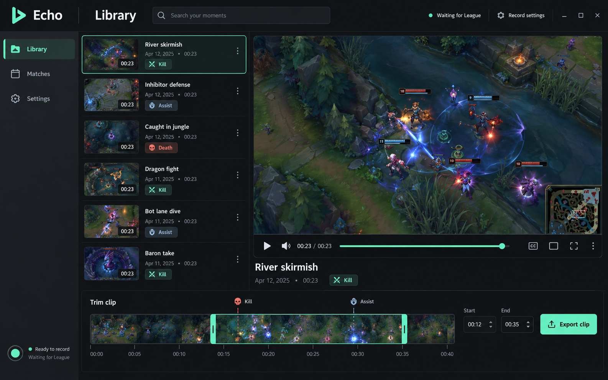

<p align="center"></p>

# Echo

**Keep the moment.** A local League of Legends recorder for Windows, built with C#, WPF and libobs.

Automatically preserve your kills, assists and deaths, or record a full match and return to its moments later. Game audio is on by default. Desktop audio and your microphone are optional.

> **Early development · v0.1.0-dev.** Native recording, replay saves, event fixtures and application-audio isolation have been exercised locally. Live League event acceptance and paired gameplay FPS measurements are still in progress. There is no zero-FPS-impact claim and no public installer yet.

## What Echo does

- **Clips only:** one hardware encoder, a bounded encoded replay buffer, and event-driven saves with configurable lead-in and tail.
- **Full match:** record once, retain event ranges, and export only the moments you choose.
- **Your game's audio:** application audio by default; no automatic fallback to desktop sound. Enabling desktop sound captures the full mix without doubling the game source.
- **Local library:** English WPF interface, search, event filters, playback, timestamp markers, range editing and MP4 export.
- **Independent recorder:** closing the library leaves recording running. Tray controls pause capture, resume it, save a manual moment or exit the recorder.
- **Hardware first:** NVENC, AMD AMF or Intel QSV H.264. Recording does not silently fall back to CPU encoding.
- **Local files:** no account, uploads, cloud storage, in-game overlay or pixel analysis.

## Interface direction



This is the selected **design mockup**, not a screenshot of verified gameplay or a finished application. Its game imagery and example clips are illustrative. The implemented library uses actual recordings and an empty state when none exist.

## Requirements

- Windows 10/11 x64; application audio and WGC require suitable Windows builds. Windows 11 is the initial development target.
- A working hardware H.264 encoder and current GPU drivers.
- .NET 10 Desktop Runtime to run; .NET 10 SDK to build.
- OBS Studio **33.x runtime files** for development. OBS Studio's application does **not** have to run. The build script can copy selected runtime components into a portable Echo folder.
- FFmpeg available on PATH when preparing the runtime. A separate FFprobe executable is not bundled.

## Build and run

```powershell
git clone https://github.com/Yimikami/echo-lol.git
cd echo-lol
pwsh ./scripts/build.ps1 -BundleRuntime -ObsDirectory "C:\Program Files\obs-studio"
./artifacts/app/Echo.exe
```

The setup script reads your installed/extracted OBS files and copies dependencies into `artifacts/app`; it does not change OBS or League. `artifacts/`, runtime files, local profiles, clips and logs are ignored by Git. Framework-dependent output keeps the .NET runtime out of this initial package.

The recorder chooses `runtime/` beside the app when present, otherwise the configured `obsDirectory`, `ECHO_OBS_DIR`, or the standard OBS installation. Application settings and status live in `%LOCALAPPDATA%\Echo`; recordings default to `%USERPROFILE%\Videos\Echo`. A custom profile is supported with `Echo.exe --data-dir C:\path\to\profile`.

## Fullscreen and capture privacy

Select a video method explicitly in Settings:

- **Game window:** Windows Graphics Capture. Appropriate for windowed/borderless games and some fullscreen configurations; exclusive fullscreen may fail.
- **Fullscreen game display:** DirectX desktop duplication of the monitor containing the game. The game must fill that monitor. A foreground check on each OBS composition masks the scene when another application has focus. Visible overlays and notifications can still be included while the game is foreground; this is display capture, not isolated game rendering. Focus transitions and exclusive fullscreen require live acceptance before privacy or compatibility guarantees can be made.

Echo never silently switches from window capture to display capture. No game process memory is read and no game-capture DLL is injected by the selected capture paths. Fullscreen support is under active testing; changing your game mode is not a prerequisite for contributing a test.

## Playback and trimming

Select a moment, play it, drag the start/end controls or enter `minutes:seconds`, then export an MP4. Full-match moments reference the original recording until export. Exports are serial in the UI, are disabled during recording, and stop if a recording starts. Export creates a new file and preserves the original.

Recording uses MKV while active so a normal application interruption does not depend on finalizing an MP4 header. After recording stops, Echo validates and remuxes to MP4 for playback without re-encoding. If preparation fails, the original file and session information remain available. A replay save may retain a little extra footage around the selected range; exported ranges are encoded for accurate boundaries.

## Verify and measure

```powershell
dotnet run --project tests/Echo.Tests -c Release
./artifacts/app/Echo.Recorder.exe --diagnose
./artifacts/app/Echo.Recorder.exe --record --synthetic --mode clips --seconds 22
```

The standalone recording command is a **test harness**. It injects labeled event fixtures, not actual League events. Real capture starts through the recorder's default watch mode. Test with a separate `--data-dir` when a recorder is already running.

See [validation](docs/validation.md) for evidence and open acceptance checks, and [performance](docs/performance.md) for measurement definitions and limits. CPU/RAM figures from a test window are not gameplay FPS results. PresentMon is optional and must be obtained from its official project; Echo does not install a driver or alter Windows permissions.

## Architecture

```text
WPF library  ── local, user-only named pipe ── Recorder host
                                              ├─ Riot local Live Client Data API
                                              ├─ libobs capture + hardware encoder
                                              └─ Video files + atomic session sidecars
```

Pixels stay in native capture/encoding code. Riot event IDs and timestamps drive moments; score deltas are not the primary detector. Long fights are flushed before a bounded replay buffer can discard their beginning. The initial catalog uses portable JSON sidecars; SQLite is intentionally deferred until library size warrants it. See the [architecture decision](docs/architecture.md).

## Contributing

Keep changes focused and commits descriptive (`feat(recorder): ...`, `fix(audio): ...`). Run the core tests and Windows build. For recording issues, include capture method, GPU/driver, Windows version, codec and a redacted diagnostic log; do not attach personal recordings or account data without reviewing them. Add a regression case for event timing, reconnects, audio policy or output lifecycle changes.

Priorities: live League acceptance, fullscreen/focus transitions, longer stability runs, AMD/Intel testing, crash recovery, and a signed installer. The repository is source-first; a local portable build is not a signed or broadly validated release.

## License and credits

GPL-3.0-or-later. Uses OBS Studio/libobs and FFmpeg; see [third-party notices](THIRD_PARTY_NOTICES.md). Design research included Segra, RePlays and Rewa. Echo uses original application code and original bindings to the documented libobs C API.

Echo isn't endorsed by Riot Games and doesn't reflect the views or opinions of Riot Games or anyone officially involved in producing or managing Riot Games properties. Riot Games, and all associated properties are trademarks or registered trademarks of Riot Games, Inc.
