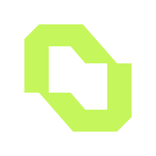
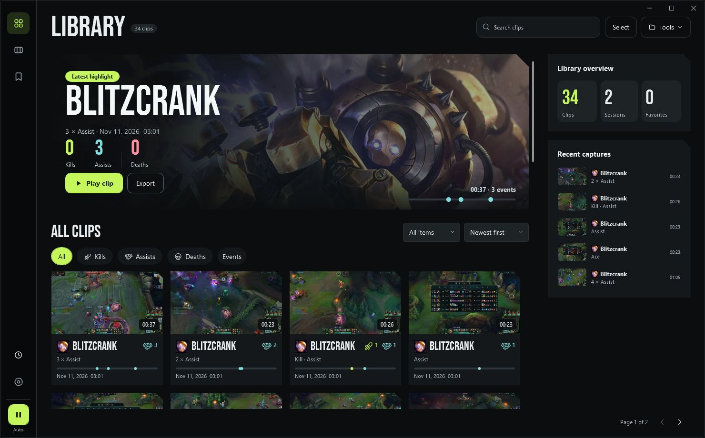
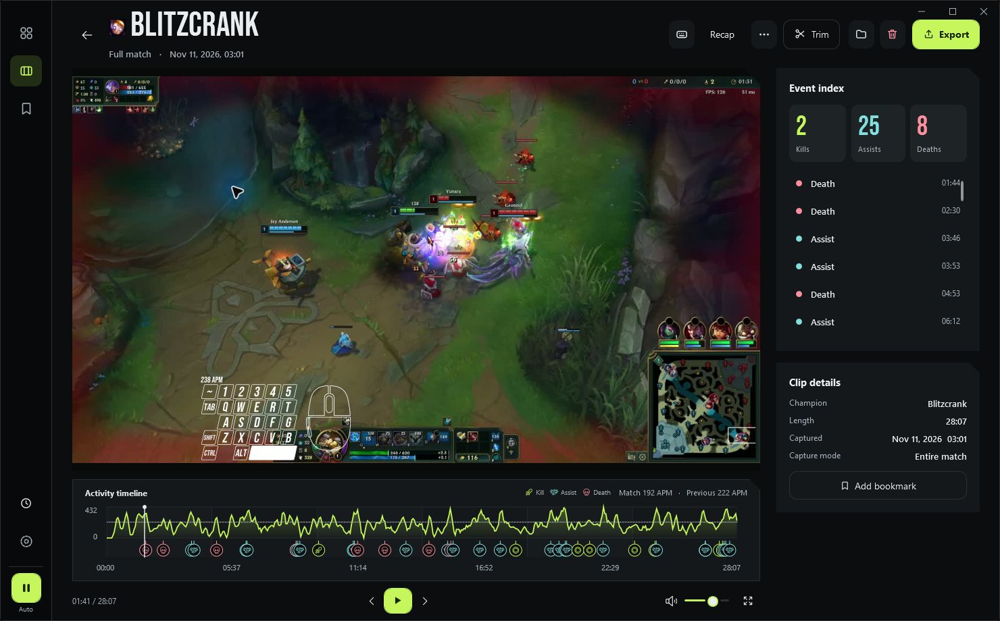
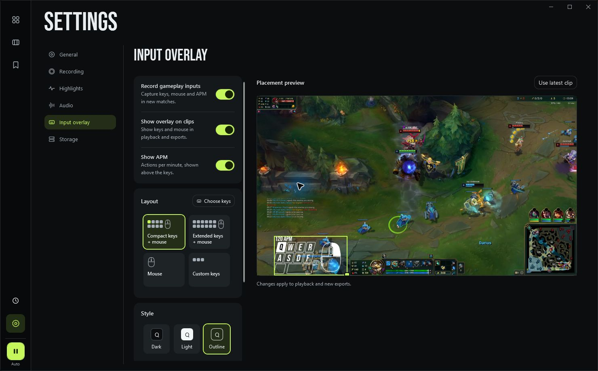

  <picture>
    <source media="(prefers-color-scheme: light)" srcset="assets/brand/echo-emblem-light.svg" />
    
  </picture>

<h1 align="center">Echo</h1>

Automatic highlights and full-match recording for League of Legends.

Native Windows app · Hardware encoding · No account required

  <strong><a href="https://github.com/Yimikami/echo-lol/releases/latest">Download for Windows</a></strong>
  · <a href="https://github.com/Yimikami/echo-lol/issues">Report an issue</a>
  · <a href="#build-from-source">Build from source</a>

  

## Play. Echo handles the recording.

1. Install **Echo-Setup** from the [latest release](https://github.com/Yimikami/echo-lol/releases/latest), or extract the portable ZIP and open **Echo.exe**.
2. Choose **Highlights only** or **Entire match**. Setup walks you through quality, audio, events, clip length and your save shortcut; you can also skip it.
3. Enter a League match. Echo records automatically and keeps running in the tray when you close the library. **Ctrl+Shift+F8** saves a moment manually; change it in Settings.

Game audio is on by default. Desktop audio and microphone are optional. Your recordings stay on your PC.

Requires **Windows 10/11 x64** and a supported hardware H.264 encoder. Release downloads include .NET, the OBS runtime and FFmpeg.

## From a good play to a clip

- **Automatic highlights.** Choose kills, assists, deaths, multikills and objectives, with time before and after each event. Nearby events are grouped into one fight clip during post-match preparation.
- **Match review.** Jump to events, add bookmarks and follow your APM on the activity timeline. Turn selected moments into a recap with visible export progress.
- **Ready to share.** Trim and export landscape, square or vertical MP4s, with optional League HUD framing and keyboard/mouse overlays.
- **A local library.** Search, favorite, tag and select clips in bulk. Manage storage, restore items from Trash, or back up your library.

  

## Make the overlay yours

Choose the keys you use, a mouse layout and a style. Drag and resize the overlay over a frame from your own recording; Echo remembers its position for playback and exports.

Enable **Record gameplay inputs** in **Settings → Input overlay** before a match to capture keys, mouse buttons and APM. Overlay visibility is a separate setting.

  

## Build from source

Developer setup

Requires PowerShell 7, the .NET 10 SDK, OBS Studio 33.x and FFmpeg on PATH.

~~~powershell
git clone https://github.com/Yimikami/echo-lol.git
cd echo-lol
pwsh ./scripts/build.ps1 -BundleRuntime -SelfContained -ObsDirectory "C:\Program Files\obs-studio"
./artifacts/app/Echo.exe
~~~

The app uses C#/.NET, WPF and a separate libobs recorder process.

[Architecture](docs/architecture.md) · [Validation](docs/validation.md) · [Development downloads](https://github.com/Yimikami/echo-lol/releases/tag/development)

## License

[GPL-3.0-or-later](LICENSE) · [Third-party notices](THIRD_PARTY_NOTICES.md)

Echo isn't endorsed by Riot Games and doesn't reflect the views or opinions of Riot Games or anyone officially involved in producing or managing Riot Games properties. Riot Games and all associated properties are trademarks or registered trademarks of Riot Games, Inc.
