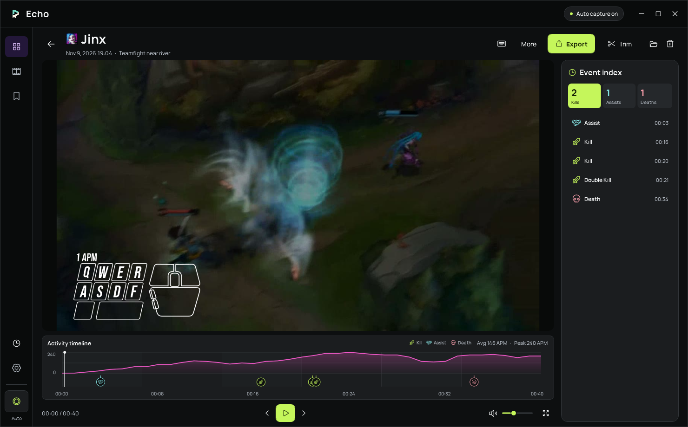

<p align="center">
  
</p>

<h1 align="center">Echo</h1>

<p align="center">Automatic highlights and full-match recording for League of Legends on Windows.</p>

<p align="center">
  <strong><a href="https://github.com/Yimikami/echo-lol/releases/latest">Download for Windows</a></strong>
  · <a href="https://github.com/Yimikami/echo-lol/issues">Report an issue</a>
</p>


## Get started

1. Download **Echo-Setup** from the latest release, or extract the portable ZIP and run **Echo.exe**. Both include .NET, the OBS runtime and FFmpeg.
2. Choose **Highlights only** or **Entire match** during setup. Echo starts recording when you enter a League match and keeps running in the system tray when you close the library.
3. Find your recordings in **Library** or **Matches**. Press **Ctrl+Shift+F8** in-game to save a moment manually, or change the shortcut in Settings.

Echo runs on Windows 10/11 x64 and uses a hardware H.264 encoder. Recordings are saved locally. Game audio is captured by default, with desktop audio and microphone available separately.

## Capture, review, share

- **Capture the moments you want.** Automatically save kills, assists, deaths, multikills and objectives. Set how much video to keep before and after each event.
- **Review the whole match.** Jump to event markers, bookmark plays and build a recap. Enable **Record gameplay inputs** under **Settings → Highlights** before a match to add an APM graph and a customizable keyboard and mouse overlay.
- **Export and organize.** Trim and export original, square or vertical MP4s, with optional HUD and input overlays. Use bulk selection, favorites and tags to manage your library.



*Screenshots show the Echo interface with demo recordings and [Riot Games gameplay footage](https://www.leagueoflegends.com/en-us/how-to-play/).*

## Build from source

<details>
<summary>Build instructions</summary>

Requires the .NET 10 SDK, the OBS Studio 33 runtime, and FFmpeg on PATH. The local build below also uses the .NET 10 Desktop Runtime.

```powershell
git clone https://github.com/Yimikami/echo-lol.git
cd echo-lol
pwsh ./scripts/build.ps1 -BundleRuntime -ObsDirectory "C:\Program Files\obs-studio"
./artifacts/app/Echo.exe
```

[Capture and build architecture](docs/architecture.md) · [Validation](docs/validation.md) · [Development builds](https://github.com/Yimikami/echo-lol/releases/tag/development)

</details>

## License

[GPL-3.0-or-later](LICENSE) · [Third-party notices](THIRD_PARTY_NOTICES.md)

Echo isn't endorsed by Riot Games and doesn't reflect the views or opinions of Riot Games or anyone officially involved in producing or managing Riot Games properties. Riot Games and all associated properties are trademarks or registered trademarks of Riot Games, Inc.
