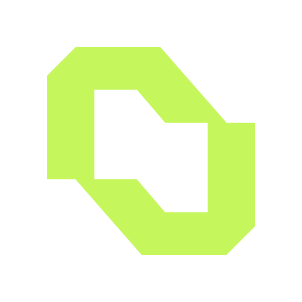
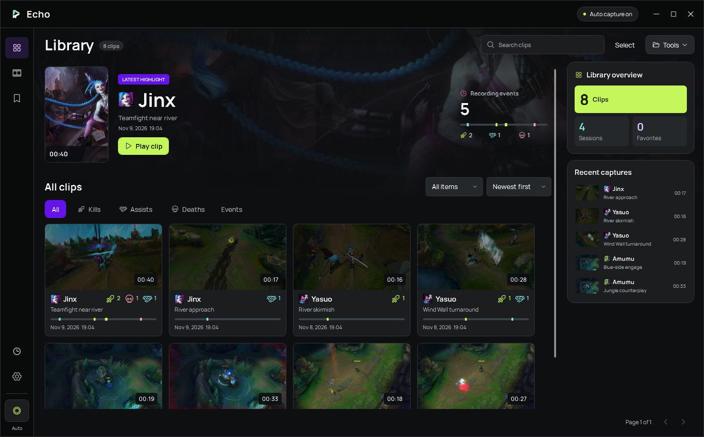

<p align="center"></p>

# Echo

A lightweight League of Legends recorder for Windows. Keep your plays, edit them, and share them.



- Automatically capture League kills, assists, deaths, multikills and objectives, or save the entire match.
- Review event markers and APM, bookmark plays, and export a recap from a recorded match.
- Select clips in bulk, organize them with favorites and tags, and restore items from Trash.
- Export original, square or vertical MP4s with optional League HUD and keyboard/mouse overlays.
- Capture game audio by default. Desktop audio, microphone and separate tracks are optional.
- Import or relink MP4s, back up the library, and set an optional storage limit.

## Download

[Download Echo for Windows](https://github.com/Yimikami/echo-lol/releases/latest). Run **Echo-Setup** or extract the portable ZIP and run **Echo.exe**.

[Development builds](https://github.com/Yimikami/echo-lol/releases/tag/development) are also available.

## Build and run

Requires Windows 10/11 x64, .NET 10 SDK, a hardware H.264 encoder, OBS Studio 33 runtime files and FFmpeg on PATH. Running a built copy requires the .NET 10 Desktop Runtime. OBS itself does not need to be running.

```powershell
git clone https://github.com/Yimikami/echo-lol.git
cd echo-lol
pwsh ./scripts/build.ps1 -BundleRuntime -ObsDirectory "C:\Program Files\obs-studio"
./artifacts/app/Echo.exe
```

Open Echo and play League. Recording starts automatically; closing the library keeps the recorder running. Choose **Export** while watching a clip or **Select** to export several at once. Enable **Record gameplay inputs** in Highlights before a match to capture APM and the input overlay. Use **Custom keys** in Overlay settings to choose what appears in playback and exports. Use **Ctrl+Shift+F8** to save a moment manually or change the shortcut in Settings.

Fullscreen monitor capture can include everything visible on the game's monitor while League has focus. Window capture isolates the game window. See [capture details](docs/architecture.md).

## Development

Early development. Windows packages are published automatically from main; version tags create versioned releases. Hardware encoding reduces overhead, but zero FPS impact is not guaranteed. See [validation](docs/validation.md), [build architecture](docs/architecture.md) and [contributing](https://github.com/Yimikami/echo-lol/issues).

## License

GPL-3.0-or-later. Built with libobs, FFmpeg, WPF UI, Phosphor Icons and Manrope. [Third-party notices](THIRD_PARTY_NOTICES.md).

Echo isn't endorsed by Riot Games and doesn't reflect the views or opinions of Riot Games or anyone officially involved in producing or managing Riot Games properties. Riot Games and all associated properties are trademarks or registered trademarks of Riot Games, Inc.
